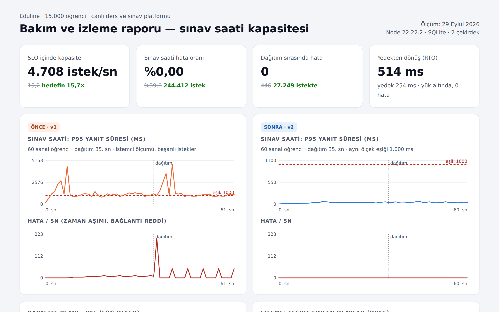

# Eduline — Eğitim Platformu Bakım, İzleme ve Kapasite Çalışması

Kurgusal bir online eğitim platformu: 15.000 öğrenci, 120 ders, 300 sınav ve 400 bin geçmiş sınav gönderimi. Platform sınav saatlerinde çöküyordu. Bu depoda sorunu yeniden üreten eski sürüm, düzeltilmiş sürüm ve sorunu **fark eden, ölçen, önleyen** operasyon düzeni bir arada:

- İzleme ajanı ve 7 uyarı kuralı, canlı durum sayfası
- Sınav saati provası, kapasite planı
- Kesintisiz dağıtım, yük altında yedek alma ve geri yükleme tatbikatı
- Nöbet kılavuzu ve aylık sağlık raporu

Tablolardaki her sayı `npm run all` ile yeniden üretilir.



## Sonuçlar

Sınav saati provası: 60 sanal öğrenci aralıksız istek gönderiyor. %60'ı cevap gönderme, %25'i sınav açma, %15'i ders listesi. 15 sn'de tepe yüke çıkılıyor ve 35. saniyede sürüm dağıtılıyor.

| | Önce (v1) | Sonra (v2) |
|---|---:|---:|
| Başarılı istek / sn | 16,3 | **4.073** |
| p95 yanıt süresi (başarılı istekler, istemci ölçümü) | 1.201 ms | **43 ms** |
| Hata oranı (zaman aşımı, bağlantı reddi/sıfırlama) | %39,6 | **%0** (244.412 istek) |
| Dağıtım sırasında hata | 446 / 841 istek | **0 / 27.249 istek** |
| Dağıtım süresi | 27,8 sn (yük altında yeniden başlama) | 4,6 sn (işçiler tek tek) |
| İzleme süresince erişilebilirlik | %75 | **%100** |
| Yük bittikten sonra toparlanma | 13 sn | ≤ 3 sn (ölçüm aralığı) |
| Tespit edilen olay | 4 (3 kritik) | 0 |

**Kapasite planı** (`reports/capacity.json`). Hedef: 3.000 eşzamanlı öğrenci × öğrenci başına 10 sn'de 1 istek = **300 istek/sn**. SLO: p95 ≤ 500 ms, hata ≤ %1.

| | SLO içinde en yüksek | Hedefe göre |
|---|---:|---:|
| Önce | 15,2 istek/sn (yalnızca 1 eşzamanlı kullanıcıda) | 0,05× |
| Sonra | 4.708 istek/sn | **15,7×** |

Yük üreteci aynı 2 çekirdekli makinede çalıştığı için v2'nin tavanını üretecin kendisi belirliyor. Gerçek kapasite en az bu kadar.

**Yedek tatbikatı** (`reports/backup-drill.json`): Saniyede 3.816 isteklik yük altında 61 MB'lık tutarlı yedek 254 ms'de alındı. Yük sırasında 0 hata oldu. Bütünlük kontrolü `ok`, SHA-256 kaydedildi. Yedekten yeni sunucu 514 ms'de sağlıklı yanıt verdi ve örnek gönderim `201` döndü.

## Kök nedenler (v1) ve düzeltmeler (v2)

`app/v1.mjs` devralınan hâliyle bilinçli olarak korunuyor. `app/v2.mjs` aynı API'yi sunuyor ve **aynı sonuçları üretiyor**: `test/esdegerlik.test.mjs`, 60 rastgele gönderimde notu, sıralamayı ve mükerrer kontrolünü iki sürümde karşılaştırıyor.

| Sorun | Düzeltme |
|---|---|
| 400 bin satırlık `submissions` tablosunda indeks yok. Her gönderimde mükerrer kontrolü, sıralama ve toplam sayımı tam tarama yapıyor. | `(exam_id, student_id)` UNIQUE ve `(exam_id, score)` indeksleri eklendi. Mükerrer kontrolü artık kısıtla, tek yazmada yapılıyor. |
| Notlandırma soru başına ayrı sorgu atıyor (40 soru = 40 indekssiz sorgu). | Sınav ve cevap anahtarı bellekte önbellekleniyor (TTL). Notlandırma bellekte, yazma tek işlemde. |
| Sorgular her istekte yeniden hazırlanıyor. | Hazır ifadeler (prepared statements) bir kez oluşturuluyor. |
| Tek süreç, senkron SQLite çağrıları olay döngüsünü kilitliyor. | Süreç kümesi (çekirdek başına işçi), WAL, `synchronous=NORMAL`, `busy_timeout`. |
| Dağıtım = süreci durdur/başlat. Yük altındaki eski sunucu, vazgeçilmiş istekleri işlemeye devam ettiği için 27 sn geç ayağa kalkıyor. | `SIGHUP` ile işçiler tek tek yenileniyor; yenisi dinlemeye başlamadan eskisi kapanmıyor. |

## Ölçerken bulunan üç gerçek sorun

1. **Sunucu içi metrikler kuyruğu göremez.** v1'de sunucunun kendi ölçtüğü p95 ~185 ms görünürken kullanıcılar 5 sn'de zaman aşımına düşüyordu: istekler işlenmeden önce kuyrukta bekliyor. Çözüm olarak `perf_hooks.monitorEventLoopDelay` ile **olay döngüsü gecikmesi** metriği ve kuralı eklendi (eşik 500 ms). Provada sorunu 6 sn içinde yakaladı. Sentetik öğrenci yolculuğu da ikinci bir güvence.
2. **Kesintisiz dağıtımın ilk hâli kesintiliydi.** Eski işçi `server.close()` ile kapanırken boşta bekleyen keep-alive soketleri kapatıyor; istemci aynı anda o sokete yeni istek yazınca `ECONNRESET` oluşuyordu. İlk provada 75 hata ölçüldü. Boşaltma sırasında her yanıta `Connection: close` eklendi ve yeni bağlantı kabulü 2 sn sonra durduruldu. Sonuç: 27.249 istekte 0 hata.
3. **SQLite'ın sayfa sayfa yedek API'si yoğun yazma altında bitmiyor.** Kaynak başka bir bağlantıdan her yazıldığında yedek baştan başlıyor. İlk tatbikatta ancak yük bitince (9,2 sn) tamamlandı. `VACUUM INTO` (tek okuma işlemi içinde tutarlı anlık görüntü) ile 254 ms'ye indi.

## İzleme (`monitor/`)

- **Yoklamalar:** 1–2 sn aralıkla `/health`, `/ready`, sentetik öğrenci yolculuğu (ders listesi → sınav açma) ve `/metrics.json` kazıma paralel çalışır.
- **Kurallar** (`monitor/rules.mjs`, saf fonksiyon, testli). Her kuralın bir eşiği ve bir `forSec` süresi var; kısa sıçramalar uyarı üretmez. Kurallar: API erişilemiyor, veritabanı hazır değil, p95 > 1 sn (uyarı) / > 3 sn (kritik), olay döngüsü gecikmesi > 500 ms, hata oranı > %2, sentetik yolculuk > 2 sn.
- **Olaylar:** Başlangıç, tespit gecikmesi, süre ve en kötü değer kaydedilir. Uyarılar `alerts.log` dosyasına ve isteğe bağlı olarak webhook'a (Slack/Teams) gider.
- **Durum sayfası** (`monitor/status-page.mjs`): Bileşen durumları, erişilebilirlik, p95 ve trafik grafikleri, olay listesi. Bağımlılıksız tek HTML, açık/koyu tema.
- **Metrikler** (`app/metrics.mjs`): Prometheus metin biçiminde (`/metrics`), rota başına histogram ve sayaç, olay döngüsü gecikmesi. Küme modunda ana süreç tüm işçilerin anlık görüntüsünü IPC ile birleştirir.

Nöbet ve müdahale adımları: [`docs/RUNBOOK.md`](docs/RUNBOOK.md).

## Çalıştırma

```bash
npm install
npm run seed          # data/base.db (+ v1.db, v2.db) — deterministik, ~3 sn
npm run start:v2      # http://localhost:8302  (küme, 2+ işçi)
npm run monitor       # durum sayfası http://localhost:8400
npm run deploy        # başka bir terminalde: kesintisiz dağıtım
npm test              # 10 test: kurallar, metrikler, v1 ≡ v2 eşdeğerliği
npm run all           # seed → test → prova (v1, v2) → kapasite → yedek tatbikatı → audit → rapor
```

Rapor ve ekran görüntüleri için Playwright gerekir (`npx playwright install chromium`).

## Teknolojiler

Node.js 22 (http, cluster, perf_hooks, bağımlılıksız), better-sqlite3 (WAL), Prometheus metin biçimi, `node:test`, Playwright (rapor ve durum sayfası görüntüleri). Framework, APM servisi ya da dış izleme aracı kullanılmadı; her parça okunabilir ve depoda duruyor.

## Lisans

MIT — Uğur Can Elsun
